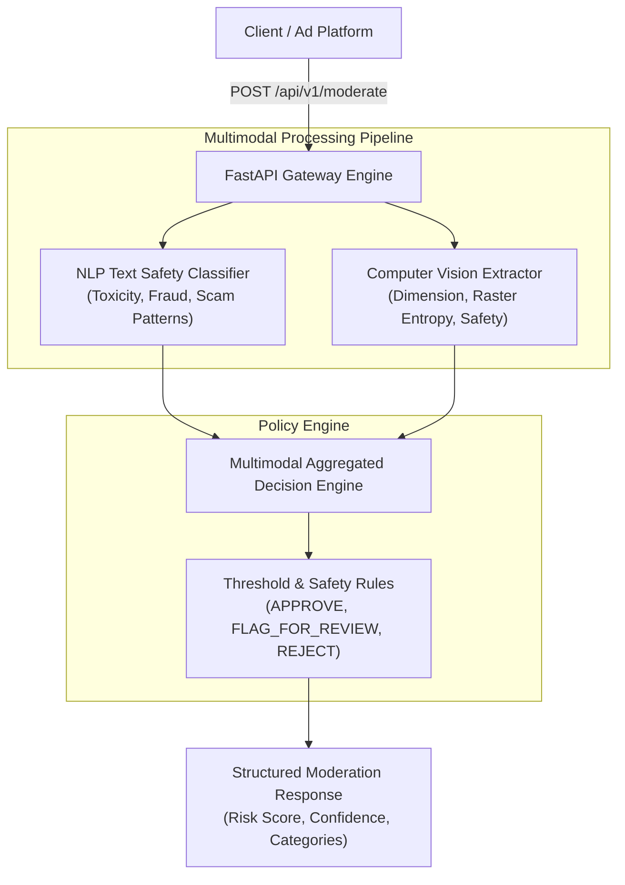

# Multimodal AI Ad Content Moderation Engine

[](https://github.com/awanish5101/multimodal-ad-moderator/actions)
[](https://www.python.org/)
[](https://fastapi.tiangolo.com)
[](https://www.docker.com)
[](https://opensource.org/licenses/MIT)

An end-to-end multimodal machine learning and heuristic policy enforcement service for automated advertising content safety, toxicity classification, and fraud detection.

---

## Architecture Overview



---

## Core Capabilities

1. **NLP Text Safety Classification:** Evaluates input headlines and copy for high-risk fraud triggers, deceptive marketing claims, toxic language, and sentiment propensity.
2. **Computer Vision Safety Extraction:** Processes image attachments and base64 payloads to assess color entropy, explicit markers, and standardized feature vectors.
3. **Aggregated Multimodal Decision Engine:** Combines heterogeneous model signals using dynamic policy thresholds to produce deterministic outcomes (`APPROVE`, `FLAG_FOR_REVIEW`, `REJECT`) with confidence scores.
4. **Production FastAPI Service:** High-performance REST interface with OpenAPI documentation, interactive Swagger UI, and Docker containerization.

---

## API Specification

### Endpoint: `POST /api/v1/moderate`

**Sample Request Payload:**
```json
{
  "ad_id": "AD-84920",
  "headline": "Eco-friendly insulated stainless steel bottles",
  "body_text": "Special 15% discount on all reusable hydration gear this week.",
  "image_url": "https://example.com/assets/bottle.jpg"
}
```

**Sample Response Payload:**
```json
{
  "ad_id": "AD-84920",
  "overall_action": "APPROVE",
  "overall_risk_score": 12.5,
  "violation_categories": ["SAFE"],
  "confidence": 0.94,
  "text_analysis": {
    "toxicity_score": 0.05,
    "fraud_score": 0.08,
    "flagged_keywords": [],
    "sentiment": "POSITIVE"
  },
  "decision_reason": "Content passed all automated multimodal safety checks."
}
```

---

## Local Setup & Testing

### 1. Environment Installation
```bash
git clone https://github.com/awanish5101/multimodal-ad-moderator.git
cd multimodal-ad-moderator
python3 -m venv venv
source venv/bin/activate
pip install -r requirements.txt
```

### 2. Run Test Suite
```bash
PYTHONPATH=. pytest tests/ -v
```

### 3. Start Local Server
```bash
uvicorn src.main:app --host 0.0.0.0 --port 8000 --reload
```

---

## Docker Deployment
```bash
docker build -t multimodal-ad-moderator:latest .
docker run -p 8000:8000 multimodal-ad-moderator:latest
```

---

## License

This project is licensed under the MIT License.
